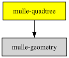

# mulle-quadtree

#### 🌴 mulle-quadtree for tracking rectangles

This library is used to enable "mouse over" functionality aka
"tracking rectangles". You feed it a set of rectangles. After that you can
do a hit test to find the top most rectangle, that's at the given location.

MulleQuadtree is very loosely based on the MIT Licensed:
Kvad - a C99 quadtree implementation
[//github.com/appscape/kvad](//github.com/appscape/kvad), so this is licensed
MIT as well.


| Release Version                                       | Release Notes  | AI Documentation
|-------------------------------------------------------|----------------|---------------
|  [](//github.com/mulle-gfx/mulle-quadtree/actions) | [RELEASENOTES](RELEASENOTES.md) | [DeepWiki for mulle-quadtree](https://deepwiki.com/mulle-gfx/mulle-quadtree)


## Documentation & Guides

* [API Summary](asset/dox/api/toc)

## Usage

Feed rectangles with payloads into the tree, then hit test a point. This is
how "mouse over" (tracking rectangles) is implemented:

``` c
#include <mulle-quadtree/mulle-quadtree.h>

static void  hit( CGRect rect, void *payload, void *context)
{
   (void) rect;
   (void) context;
   printf( "mouse over: %s\n", (char *) payload);
}

int  main( void)
{
   struct mulle_quadtree  *tree =
      mulle_quadtree_create( CGRectMake( 0, 0, 800, 600), 3, 100, NULL);

   mulle_quadtree_insert( tree, CGRectMake(  10,  10, 200, 100), "left window");
   mulle_quadtree_insert( tree, CGRectMake( 500, 300, 200, 200), "right window");

   mulle_quadtree_find_point( tree, CGPointMake( 150, 50), hit, NULL);

   mulle_quadtree_destroy( tree);
   return( 0);
}
```


### You are here




## Add


### Add mulle-quadtree as a cmake subproject

In your code include its header:

``` c
#include <mulle-quadtree/mulle-quadtree.h>
```

Add mulle-quadtree and dependencies as git submodules and link against
them:

``` bash
git submodule add -f --name "m" \
                            "" \
                            "stash/m"
git submodule add -f --branch * --name "mintomic" \
                            "clib:mulle-concurrent/mintomic@*" \
                            "stash/mintomic"
git submodule add -f --branch * --name "dlfcn-win32" \
                            "clib:mulle-core/dlfcn-win32@*" \
                            "stash/dlfcn-win32"
git submodule add -f --branch * --name "src/mulle-aba" \
                            "clib:mulle-concurrent/mulle-aba@*" \
                            "stash/src/mulle-aba"
git submodule add -f --branch * --name "src/mulle-allocator" \
                            "clib:mulle-c/mulle-allocator@*" \
                            "stash/src/mulle-allocator"
git submodule add -f --branch * --name "src/mulle-buffer" \
                            "clib:mulle-c/mulle-buffer@*" \
                            "stash/src/mulle-buffer"
git submodule add -f --branch * --name "src/mulle-c11" \
                            "clib:mulle-c/mulle-c11@*" \
                            "stash/src/mulle-c11"
git submodule add -f --branch * --name "src/mulle-concurrent" \
                            "clib:mulle-concurrent/mulle-concurrent@*" \
                            "stash/src/mulle-concurrent"
git submodule add -f --branch * --name "src/mulle-container-debug" \
                            "clib:mulle-c/mulle-container-debug@*" \
                            "stash/src/mulle-container-debug"
git submodule add -f --branch * --name "src/mulle-container" \
                            "clib:mulle-c/mulle-container@*" \
                            "stash/src/mulle-container"
git submodule add -f --branch * --name "src/mulle-data" \
                            "clib:mulle-c/mulle-data@*" \
                            "stash/src/mulle-data"
git submodule add -f --branch * --name "src/mulle-dlfcn" \
                            "clib:mulle-core/mulle-dlfcn@*" \
                            "stash/src/mulle-dlfcn"
git submodule add -f --branch * --name "src/mulle-dtostr" \
                            "clib:mulle-core/mulle-dtostr@*" \
                            "stash/src/mulle-dtostr"
git submodule add -f --branch * --name "src/mulle-fifo" \
                            "clib:mulle-concurrent/mulle-fifo@*" \
                            "stash/src/mulle-fifo"
git submodule add -f --branch * --name "src/mulle-fprintf" \
                            "clib:mulle-core/mulle-fprintf@*" \
                            "stash/src/mulle-fprintf"
git submodule add -f --branch * --name "src/mulle-http" \
                            "clib:mulle-c/mulle-http@*" \
                            "stash/src/mulle-http"
git submodule add -f --branch * --name "src/mulle-linkedlist" \
                            "clib:mulle-concurrent/mulle-linkedlist@*" \
                            "stash/src/mulle-linkedlist"
git submodule add -f --branch * --name "src/mulle-mmap" \
                            "clib:mulle-core/mulle-mmap@*" \
                            "stash/src/mulle-mmap"
git submodule add -f --branch * --name "src/mulle-multififo" \
                            "clib:mulle-concurrent/mulle-multififo@*" \
                            "stash/src/mulle-multififo"
git submodule add -f --branch * --name "src/mulle-rbtree" \
                            "clib:mulle-c/mulle-rbtree@*" \
                            "stash/src/mulle-rbtree"
git submodule add -f --branch * --name "src/mulle-rbtree-debug" \
                            "clib:mulle-core/mulle-rbtree-debug@*" \
                            "stash/src/mulle-rbtree-debug"
git submodule add -f --branch * --name "src/mulle-regex" \
                            "clib:mulle-c/mulle-regex@*" \
                            "stash/src/mulle-regex"
git submodule add -f --branch * --name "src/mulle-slug" \
                            "clib:mulle-c/mulle-slug@*" \
                            "stash/src/mulle-slug"
git submodule add -f --branch * --name "src/mulle-sprintf" \
                            "clib:mulle-core/mulle-sprintf@*" \
                            "stash/src/mulle-sprintf"
git submodule add -f --branch * --name "src/mulle-storage" \
                            "clib:mulle-c/mulle-storage@*" \
                            "stash/src/mulle-storage"
git submodule add -f --branch * --name "src/mulle-thread" \
                            "clib:mulle-concurrent/mulle-thread@*" \
                            "stash/src/mulle-thread"
git submodule add -f --branch * --name "src/mulle-time" \
                            "clib:mulle-core/mulle-time@*" \
                            "stash/src/mulle-time"
git submodule add -f --branch * --name "src/mulle-unicode" \
                            "clib:mulle-c/mulle-unicode@*" \
                            "stash/src/mulle-unicode"
git submodule add -f --branch * --name "src/mulle-url" \
                            "clib:mulle-c/mulle-url@*" \
                            "stash/src/mulle-url"
git submodule add -f --branch * --name "src/mulle-utf" \
                            "clib:mulle-c/mulle-utf@*" \
                            "stash/src/mulle-utf"
git submodule add -f --branch * --name "src/mulle-vararg" \
                            "clib:mulle-c/mulle-vararg@*" \
                            "stash/src/mulle-vararg"
git submodule add -f --name "stdthreads" \
                            "" \
                            "stash/stdthreads"
git submodule add -f --name "pthread" \
                            "" \
                            "stash/pthread"
git submodule add -f --name "src/mulle-spawn" \
                            "clib:mulle-core/mulle-spawn@*" \
                            "stash/src/mulle-spawn"
git submodule add -f --name "src/mulle-socket" \
                            "clib:mulle-core/mulle-socket@*" \
                            "stash/src/mulle-socket"
git submodule add -f --name "ws2_32" \
                            "" \
                            "stash/ws2_32"
git submodule add -f --name "mulle-core" \
                            "https://github.com/mulle-core/mulle-core.git" \
                            "stash/mulle-core"
git submodule add -f --name "math" \
                            "" \
                            "stash/math"
git submodule add -f --name "mulle-geometry" \
                            "https://github.com/MulleUI/mulle-geometry.git" \
                            "stash/mulle-geometry"
git submodule add -f --name "mulle-quadtree" \
                        "https://github.com/mulle-gfx/mulle-quadtree" \
                        "stash/mulle-quadtree"
git submodule update --init --recursive
```

``` cmake
include_directories( SYSTEM "${CMAKE_BINARY_DIR}/include")

add_subdirectory( stash/m)
add_subdirectory( stash/mintomic)
add_subdirectory( stash/dlfcn-win32)
add_subdirectory( stash/src/mulle-aba)
add_subdirectory( stash/src/mulle-allocator)
add_subdirectory( stash/src/mulle-buffer)
add_subdirectory( stash/src/mulle-c11)
add_subdirectory( stash/src/mulle-concurrent)
add_subdirectory( stash/src/mulle-container-debug)
add_subdirectory( stash/src/mulle-container)
add_subdirectory( stash/src/mulle-data)
add_subdirectory( stash/src/mulle-dlfcn)
add_subdirectory( stash/src/mulle-dtostr)
add_subdirectory( stash/src/mulle-fifo)
add_subdirectory( stash/src/mulle-fprintf)
add_subdirectory( stash/src/mulle-http)
add_subdirectory( stash/src/mulle-linkedlist)
add_subdirectory( stash/src/mulle-mmap)
add_subdirectory( stash/src/mulle-multififo)
add_subdirectory( stash/src/mulle-rbtree)
add_subdirectory( stash/src/mulle-rbtree-debug)
add_subdirectory( stash/src/mulle-regex)
add_subdirectory( stash/src/mulle-slug)
add_subdirectory( stash/src/mulle-sprintf)
add_subdirectory( stash/src/mulle-storage)
add_subdirectory( stash/src/mulle-thread)
add_subdirectory( stash/src/mulle-time)
add_subdirectory( stash/src/mulle-unicode)
add_subdirectory( stash/src/mulle-url)
add_subdirectory( stash/src/mulle-utf)
add_subdirectory( stash/src/mulle-vararg)
add_subdirectory( stash/stdthreads)
add_subdirectory( stash/pthread)
add_subdirectory( stash/src/mulle-spawn)
add_subdirectory( stash/src/mulle-socket)
add_subdirectory( stash/ws2_32)
add_subdirectory( stash/mulle-core)
add_subdirectory( stash/math)
add_subdirectory( stash/mulle-geometry)
add_subdirectory( stash/mulle-quadtree)

target_link_libraries( ${PROJECT_NAME} PUBLIC m)
target_link_libraries( ${PROJECT_NAME} PUBLIC mintomic)
target_link_libraries( ${PROJECT_NAME} PUBLIC dlfcn-win32)
target_link_libraries( ${PROJECT_NAME} PUBLIC src/mulle-aba)
target_link_libraries( ${PROJECT_NAME} PUBLIC src/mulle-allocator)
target_link_libraries( ${PROJECT_NAME} PUBLIC src/mulle-buffer)
target_link_libraries( ${PROJECT_NAME} PUBLIC src/mulle-c11)
target_link_libraries( ${PROJECT_NAME} PUBLIC src/mulle-concurrent)
target_link_libraries( ${PROJECT_NAME} PUBLIC src/mulle-container-debug)
target_link_libraries( ${PROJECT_NAME} PUBLIC src/mulle-container)
target_link_libraries( ${PROJECT_NAME} PUBLIC src/mulle-data)
target_link_libraries( ${PROJECT_NAME} PUBLIC src/mulle-dlfcn)
target_link_libraries( ${PROJECT_NAME} PUBLIC src/mulle-dtostr)
target_link_libraries( ${PROJECT_NAME} PUBLIC src/mulle-fifo)
target_link_libraries( ${PROJECT_NAME} PUBLIC src/mulle-fprintf)
target_link_libraries( ${PROJECT_NAME} PUBLIC src/mulle-http)
target_link_libraries( ${PROJECT_NAME} PUBLIC src/mulle-linkedlist)
target_link_libraries( ${PROJECT_NAME} PUBLIC src/mulle-mmap)
target_link_libraries( ${PROJECT_NAME} PUBLIC src/mulle-multififo)
target_link_libraries( ${PROJECT_NAME} PUBLIC src/mulle-rbtree)
target_link_libraries( ${PROJECT_NAME} PUBLIC src/mulle-rbtree-debug)
target_link_libraries( ${PROJECT_NAME} PUBLIC src/mulle-regex)
target_link_libraries( ${PROJECT_NAME} PUBLIC src/mulle-slug)
target_link_libraries( ${PROJECT_NAME} PUBLIC src/mulle-sprintf)
target_link_libraries( ${PROJECT_NAME} PUBLIC src/mulle-storage)
target_link_libraries( ${PROJECT_NAME} PUBLIC src/mulle-thread)
target_link_libraries( ${PROJECT_NAME} PUBLIC src/mulle-time)
target_link_libraries( ${PROJECT_NAME} PUBLIC src/mulle-unicode)
target_link_libraries( ${PROJECT_NAME} PUBLIC src/mulle-url)
target_link_libraries( ${PROJECT_NAME} PUBLIC src/mulle-utf)
target_link_libraries( ${PROJECT_NAME} PUBLIC src/mulle-vararg)
target_link_libraries( ${PROJECT_NAME} PUBLIC stdthreads)
target_link_libraries( ${PROJECT_NAME} PUBLIC pthread)
target_link_libraries( ${PROJECT_NAME} PUBLIC src/mulle-spawn)
target_link_libraries( ${PROJECT_NAME} PUBLIC src/mulle-socket)
target_link_libraries( ${PROJECT_NAME} PUBLIC ws2_32)
target_link_libraries( ${PROJECT_NAME} PUBLIC mulle-core)
target_link_libraries( ${PROJECT_NAME} PUBLIC math)
target_link_libraries( ${PROJECT_NAME} PUBLIC mulle-geometry)
target_link_libraries( ${PROJECT_NAME} PUBLIC mulle-quadtree)
```

Or let [mulle-sde](//github.com/mulle-sde) do it:

``` sh
mulle-sde add github:mulle-gfx/mulle-quadtree
```

## Install

Use [mulle-sde](//github.com/mulle-sde) to build and install mulle-quadtree and all dependencies:

``` sh
mulle-sde install --prefix /usr/local \
   https://github.com/mulle-gfx/mulle-quadtree/archive/latest.tar.gz
```

### Legacy Installation

Install the requirements:

| Requirements                                 | Description
|----------------------------------------------|-----------------------
| [mulle-geometry](https://github.com/MulleUI/mulle-geometry)             | 🔭 Basic geometric types

Download the latest [tar](https://github.com/mulle-gfx/mulle-quadtree/archive/refs/tags/latest.tar.gz) or [zip](https://github.com/mulle-gfx/mulle-quadtree/archive/refs/tags/latest.zip) archive and unpack it.

Install **mulle-quadtree** into `/usr/local` with [cmake](https://cmake.org):

``` sh
PREFIX_DIR="/usr/local"
cmake -B build                               \
      -DMULLE_SDK_PATH="${PREFIX_DIR}"       \
      -DCMAKE_INSTALL_PREFIX="${PREFIX_DIR}" \
      -DCMAKE_PREFIX_PATH="${PREFIX_DIR}"    \
      -DCMAKE_BUILD_TYPE=Release &&
cmake --build build --config Release &&
cmake --install build --config Release
```


## Author

[Nat!](https://mulle-kybernetik.com/weblog) for Mulle kybernetiK  


