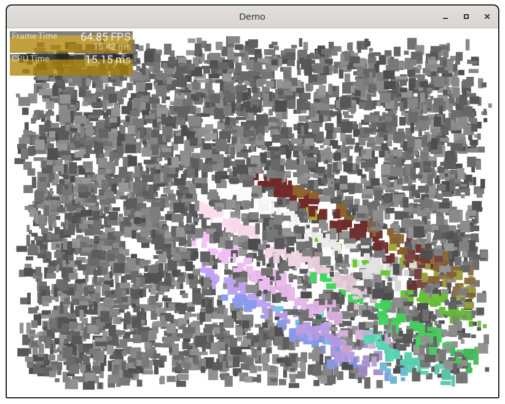

# demos

#### 🙄 demos do something

The demos actually require MulleUICore to run. It's too tedious to set
everything up again in C for linking with glfw. And basically, that's what
MulleUICore is there for anyway.

#### demo



[source](src/main-demo.m)


## Build

This is a [mulle-sde](https://mulle-sde.github.io/) project.

It comes with its own virtual environment and list of dependencies.
To fetch and build everything say:

```
mulle-sde craft --release
```
